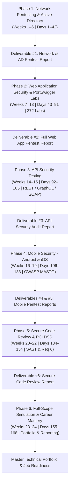

# Penetration Tester 24-Week Master Roadmap

# Unified Penetration Tester & Offensive Security Master Roadmap (24 Weeks / 6 Months)

## 1. Executive Summary & Architecture

This Master Roadmap represents the **Single Source of Truth (SSOT)** for an exhaustive, end-to-end 24-Week (6-Month, 168-Day) Offensive Security and Penetration Testing curriculum. It synthesizes and consolidates:
1. **The 24-Week Multi-Domain Penetration Tester Plan** (Network, Active Directory, Web, API, Mobile, SAST, Reporting).
2. **The 15-Week Web Application Penetration Testing Curriculum** (Methodology, Scanning, Attack Surface Analysis).
3. **The Complete PortSwigger Web Security Academy Plan** (272 Hands-on Labs across 31 Topics mapped to The_Web_Application_Hackers_Handbook_-_Finding_and_Exploiting_Security_Flaws_2nd_Edition_by_Dafydd_Stuttard_Marcus_Pinto.pdf, Bug_Bounty_Bootcamp.pdf, web-hacking-101.pdf, and OWASP_Testing_Guide_v4.pdf).

---

## 2. Interactive Browser Dashboards

For interactive tracking, day-filtering, and visual progress tracking, use the dedicated interactive web applications located in your local repository:

- 📊 **Attachments/Task/Web_Security_Academy_Full_Coverage_Plan.html**
- 🛡️ **Attachments/Task/24-Week_Penetration_Tester_Training_Plan.html**
- 🌐 **Attachments/Task/15-Week Web Application Penetration Testing Training Plan.html**

---

## 3. Four-Pillar Daily Study Protocol

Each scheduled day follows a disciplined operational cadence:
- **Theory (M):** Deep-dive conceptual study from primary references (WAHH, RFCs, NIST SP 800-115, OWASP Standards).
- **Practice (P):** Guided practical execution in dedicated training labs (TryHackMe, PortSwigger, Hack The Box Starting Point).
- **Solving (S):** Independent exploit construction, CTF challenge solving, and automated script authoring.
- **Review (R):** Synthesis into atomic Vault notes, checklist updates, and formal phase deliverables.

---

## 4. Phase-by-Phase Master Curriculum Breakdown

---

### Phase 1: Network Penetration Testing, Infrastructure & Active Directory (Weeks 1-6 / Days 1-42)

> [!NOTE] Phase Objective & Scope
> Foundational networking, aggressive port scanning, protocol enumeration, Active Directory attack mechanics, privilege escalation, and lateral movement.
> 
> **Milestone Milestone:** Deliverable #1: Full Internal Network & Active Directory Penetration Testing Report (PTES & NIST SP 800-115 format).

#### Week 1

- [ ] **Day 1 (Theory):** TCP/IP, OSI Model & Core Protocols
  - *Resources & Tools:* [Nmap Network Scanning Book](https://nmap.org/book/) | [TryHackMe: Intro to Networking](https://tryhackme.com/module/network-fundamentals) | [OWASP Testing Guide - Intro](https://owasp.org/www-project-web-security-testing-guide/)
- [ ] **Day 2 (Theory):** Nmap Scanning Techniques (SYN/UDP/Stealth)
  - *Resources & Tools:* [Nmap Reference Guide](https://nmap.org/book/man.html) | [TryHackMe: Nmap: The Basics](https://tryhackme.com/room/nmap) | [TryHackMe: Nmap Basic Port Scans](https://tryhackme.com/room/nmap02)
- [ ] **Day 3 (Practice):** Practice: Nmap Scans & Host Discovery
  - *Resources & Tools:* [TryHackMe: Nmap Live Host Discovery](https://tryhackme.com/room/nmap01) | [TryHackMe: Further Nmap](https://tryhackme.com/room/furthernmap)
- [ ] **Day 4 (Practice):** Practice: Passive & Active Recon (OSINT, DNS)
  - *Resources & Tools:* [TryHackMe: OSINT Room](https://tryhackme.com/room/ohsint) | [theHarvester](https://github.com/laramies/theHarvester)
- [ ] **Day 5 (Solving):** Solving: Advanced Nmap Scans Challenge
  - *Resources & Tools:* [TryHackMe: Nmap Advanced Port Scans](https://tryhackme.com/room/nmap03) | [HTB Academy - Nmap Module](https://academy.hackthebox.com/)
- [ ] **Day 6 (Solving):** Solving: Network Recon CTF (Starting Point)
  - *Resources & Tools:* [HackTHeBox Starting Point](https://www.hackthebox.com/hacker/hacking-labs)
- [ ] **Day 7 (Review):** Review: Week 1 - Networking & Recon Notes
  - *Resources & Tools:* [Nmap Cheat Sheet](https://nmap.org/book/man-briefoptions.html) | [OWASP Cheat Sheet Series](https://cheatsheetseries.owasp.org/)

#### Week 2

- [ ] **Day 8 (Theory):** SMB, FTP & SSH Enumeration
  - *Resources & Tools:* [PayloadsAllTheThings - Network Pentest](https://github.com/swisskyrepo/PayloadsAllTheThings/tree/master/Methodology%20and%20Resources) | [enum4linux-ng](https://github.com/cddmp/enum4linux-ng)
- [ ] **Day 9 (Theory):** SNMP, DNS & RDP Enumeration
  - *Resources & Tools:* [Nmap Scripting Engine (NSE)](https://nmap.org/book/nse.html) | [PayloadsAllTheThings](https://github.com/swisskyrepo/PayloadsAllTheThings)
- [ ] **Day 10 (Practice):** Practice: SMB/FTP Enumeration Lab
  - *Resources & Tools:* [TryHackMe: Kenobi](https://tryhackme.com/room/kenobi)
- [ ] **Day 11 (Practice):** Practice: SNMP/DNS/RDP Enumeration Lab
  - *Resources & Tools:* [TryHackMe: Network Services 2](https://tryhackme.com/module/network-fundamentals)
- [ ] **Day 12 (Solving):** Solving: Enumeration CTF Room
  - *Resources & Tools:* [TryHackMe: Ignite](https://tryhackme.com/room/ignite)
- [ ] **Day 13 (Solving):** Solving: HTB Easy Machine (Enumeration Focus)
  - *Resources & Tools:* [HTB Starting Point Tier 0](https://www.hackthebox.com/hacker/hacking-labs)
- [ ] **Day 14 (Review):** Review: Service Enumeration Cheat Sheet
  - *Resources & Tools:* [OWASP Cheat Sheet Series](https://cheatsheetseries.owasp.org/)

#### Week 3

- [ ] **Day 15 (Theory):** Active Directory Fundamentals (Domains, Trusts, GPOs)
  - *Resources & Tools:* [TryHackMe: Attacktive Directory](https://tryhackme.com/room/attacktivedirectory) | [ired.team - AD Attacks](https://ired.team/offensive-security-experiments/active-directory-kerberos-abuse)
- [ ] **Day 16 (Theory):** Kerberoasting, AS-REP Roasting & LLMNR Poisoning
  - *Resources & Tools:* [Rubeus](https://github.com/GhostPack/Rubeus) | [Responder](https://github.com/lgandx/Responder)
- [ ] **Day 17 (Practice):** Practice: Responder & LLMNR Poisoning Lab
  - *Resources & Tools:* [Responder](https://github.com/lgandx/Responder)
- [ ] **Day 18 (Practice):** Practice: Kerberoasting & AS-REP Roasting Lab
  - *Resources & Tools:* [TryHackMe: Attacking Kerberos](https://tryhackme.com/room/attackingkerberos)
- [ ] **Day 19 (Solving):** Solving: Attacktive Directory Room
  - *Resources & Tools:* [TryHackMe: Attacktive Directory](https://tryhackme.com/room/attacktivedirectory)
- [ ] **Day 20 (Solving):** Solving: HTB AD-Focused Machine
  - *Resources & Tools:* [HTB Academy - Active Directory](https://academy.hackthebox.com/)
- [ ] **Day 21 (Review):** Review: AD Attack Methodology Notes
  - *Resources & Tools:* [ired.team AD Kerberos Abuse](https://ired.team/offensive-security-experiments/active-directory-kerberos-abuse)

#### Week 4

- [ ] **Day 22 (Theory):** Linux Privilege Escalation Techniques
  - *Resources & Tools:* [GTFOBins](https://gtfobins.github.io/) | [TryHackMe: Linux PrivEsc](https://tryhackme.com/room/linuxprivesc)
- [ ] **Day 23 (Theory):** Windows Privilege Escalation Techniques
  - *Resources & Tools:* [PEASS-ng (WinPEAS/LinPEAS)](https://github.com/carlospolop/PEASS-ng) | [TryHackMe: Windows PrivEsc](https://tryhackme.com/room/windows10privesc)
- [ ] **Day 24 (Practice):** Practice: Linux PrivEsc Lab
  - *Resources & Tools:* [TryHackMe: Linux PrivEsc Arena](https://tryhackme.com/room/linuxprivescarena)
- [ ] **Day 25 (Practice):** Practice: Windows PrivEsc Lab
  - *Resources & Tools:* [TryHackMe: Windows PrivEsc Arena](https://tryhackme.com/room/windowsprivescarena)
- [ ] **Day 26 (Solving):** Solving: TryHackMe Linux PrivEsc Room
  - *Resources & Tools:* [TryHackMe: Linux PrivEsc](https://tryhackme.com/room/linuxprivesc)
- [ ] **Day 27 (Solving):** Solving: TryHackMe Windows PrivEsc Room
  - *Resources & Tools:* [TryHackMe: Windows PrivEsc](https://tryhackme.com/room/windows10privesc)
- [ ] **Day 28 (Review):** Review: PrivEsc Checklist & Cheat Sheet
  - *Resources & Tools:* [GTFOBins](https://gtfobins.github.io/) | [PEASS-ng](https://github.com/carlospolop/PEASS-ng)

#### Week 5

- [ ] **Day 29 (Theory):** Metasploit Framework Fundamentals
  - *Resources & Tools:* [Metasploit Documentation](https://docs.metasploit.com/) | [TryHackMe: Metasploit Intro](https://tryhackme.com/room/rpmetasploit)
- [ ] **Day 30 (Theory):** Vulnerability Scanning (Nessus) & Traffic Analysis (Wireshark)
  - *Resources & Tools:* [Nessus](https://www.tenable.com/products/nessus) | [Wireshark Documentation](https://www.wireshark.org/docs/)
- [ ] **Day 31 (Practice):** Practice: Metasploit Exploitation Lab
  - *Resources & Tools:* [Metasploit Unleashed](https://docs.metasploit.com/)
- [ ] **Day 32 (Practice):** Practice: Nessus Scan + Wireshark Packet Analysis
  - *Resources & Tools:* [Nessus Essentials](https://www.tenable.com/products/nessus/nessus-essentials) | [Wireshark User Guide](https://www.wireshark.org/docs/wsug_html_chunked/)
- [ ] **Day 33 (Solving):** Solving: HTB/TryHackMe Exploitation Machine
  - *Resources & Tools:* [HTB Starting Point](https://www.hackthebox.com/hacker/hacking-labs)
- [ ] **Day 34 (Solving):** Solving: Manual Exploitation (No Metasploit)
  - *Resources & Tools:* [PayloadsAllTheThings](https://github.com/swisskyrepo/PayloadsAllTheThings)
- [ ] **Day 35 (Review):** Review: Exploitation Methodology & Tool Cheat Sheet
  - *Resources & Tools:* [PTES Technical Guidelines](https://www.pentest-standard.org/index.php/PTES_Technical_Guidelines)

#### Week 6

- [ ] **Day 36 (Theory):** Network Pentest Methodology (PTES / NIST SP 800-115)
  - *Resources & Tools:* [PTES](https://www.pentest-standard.org/index.php/Main_Page) | [NIST SP 800-115](https://csrc.nist.gov/pubs/sp/800/115/final)
- [ ] **Day 37 (Theory):** Report Writing for Network Assessments
  - *Resources & Tools:* [OWASP Testing Guide - Reporting](https://owasp.org/www-project-web-security-testing-guide/)
- [ ] **Day 38 (Practice):** Practice: Full Internal Network Simulation - Day 1
  - *Resources & Tools:* [HTB Pro Labs Overview](https://www.hackthebox.com/hacker/hacking-labs)
- [ ] **Day 39 (Practice):** Practice: Full Network Simulation - Lateral Movement & PrivEsc
  - *Resources & Tools:* [ired.team Lateral Movement](https://ired.team/offensive-security-experiments/active-directory-kerberos-abuse)
- [ ] **Day 40 (Solving):** Solving: Complete End-to-End Network Assessment
  - *Resources & Tools:* [HTB Starting Point / Tier 1](https://www.hackthebox.com/hacker/hacking-labs)
- [ ] **Day 41 (Solving):** Solving: Finalize Simulation & Document Findings
  - *Resources & Tools:* [NIST SP 800-115](https://csrc.nist.gov/pubs/sp/800/115/final)
- [ ] **Day 42 (Review):** Deliverable #1: Write Full Network Pentest Report
  - *Resources & Tools:* [PTES Reporting Guidelines](https://www.pentest-standard.org/index.php/PTES_Technical_Guidelines)

---

### Phase 2: Comprehensive Web Application Penetration Testing & PortSwigger Academy (Weeks 7-13 / Days 43-91)

> [!NOTE] Phase Objective & Scope
> Complete OWASP WSTG testing methodology integrated with all 272 PortSwigger Web Security Academy labs across 31 topics, mapped to WAHH, BBB, WH101, and OTG v4.
> 
> **Milestone Milestone:** Deliverable #2: Full-Scope Web Application Penetration Testing Report (OWASP WSTG & CVSS v3.1 scoring).

#### Week 7

> [!TIP] Integrated Web Security Academy Reference
> Cross-reference with: Web Security Academy Master Roadmap for individual lab solution procedures.

- [ ] **Day 43 (Theory):** OWASP WSTG Methodology Overview
  - *Resources & Tools:* [OWASP WSTG](https://owasp.org/www-project-web-security-testing-guide/)
- [ ] **Day 44 (Theory):** Advanced Burp Suite (Macros, Extensions, Intruder)
  - *Resources & Tools:* [Burp Suite Documentation](https://portswigger.net/burp/documentation/desktop/getting-started)
- [ ] **Day 45 (Practice):** Practice: Recon & Mapping Attack Surface
  - *Resources & Tools:* [PortSwigger - Essential Skills](https://portswigger.net/web-security/all-labs)
- [ ] **Day 46 (Practice):** Practice: Burp Suite Advanced Features Lab
  - *Resources & Tools:* [Burp Suite Extensions (BApp Store)](https://portswigger.net/bappstore)
- [ ] **Day 47 (Solving):** Solving: PortSwigger Recon-Related Labs
  - *Resources & Tools:* [All PortSwigger Labs](https://portswigger.net/web-security/all-labs)
- [ ] **Day 48 (Solving):** Solving: Subdomain/Endpoint Discovery Challenge
  - *Resources & Tools:* [PayloadsAllTheThings - Recon](https://github.com/swisskyrepo/PayloadsAllTheThings/tree/master/Methodology%20and%20Resources)
- [ ] **Day 49 (Review):** Review: Web Recon Checklist
  - *Resources & Tools:* [OWASP WSTG Info Gathering](https://owasp.org/www-project-web-security-testing-guide/)

#### Week 8

> [!TIP] Integrated Web Security Academy Reference
> Cross-reference with: Web Security Academy Master Roadmap for individual lab solution procedures.

- [ ] **Day 50 (Theory):** SQL Injection - Advanced (Blind, Second-Order)
  - *Resources & Tools:* [OWASP SQL Injection](https://owasp.org/www-community/attacks/SQL_Injection) | [PortSwigger SQL Injection](https://portswigger.net/web-security/sql-injection)
- [ ] **Day 51 (Theory):** Command Injection & NoSQL Injection
  - *Resources & Tools:* [OWASP Command Injection](https://owasp.org/www-community/attacks/Command_Injection) | [NoSQL Injection Payloads](https://github.com/swisskyrepo/PayloadsAllTheThings/tree/master/NoSQL%20Injection)
- [ ] **Day 52 (Practice):** Practice: SQLi Labs
  - *Resources & Tools:* [SQL Injection Labs](https://portswigger.net/web-security/all-labs#sql-injection)
- [ ] **Day 53 (Practice):** Practice: Command Injection Labs
  - *Resources & Tools:* [OS Command Injection Labs](https://portswigger.net/web-security/all-labs#os-command-injection)
- [ ] **Day 54 (Solving):** Solving: All SQLi Labs
  - *Resources & Tools:* [All SQL Injection Labs](https://portswigger.net/web-security/all-labs#sql-injection)
- [ ] **Day 55 (Solving):** Solving: NoSQLi CTF Challenge
  - *Resources & Tools:* [NoSQL Injection Cheatsheet](https://github.com/swisskyrepo/PayloadsAllTheThings/tree/master/NoSQL%20Injection)
- [ ] **Day 56 (Review):** Review: Injection Cheat Sheet
  - *Resources & Tools:* [OWASP Injection Prevention Cheat Sheet](https://cheatsheetseries.owasp.org/cheatsheets/Injection_Prevention_Cheat_Sheet.html)

#### Week 9

> [!TIP] Integrated Web Security Academy Reference
> Cross-reference with: Web Security Academy Master Roadmap for individual lab solution procedures.

- [ ] **Day 57 (Theory):** XSS (Reflected/Stored/DOM) Advanced Bypasses
  - *Resources & Tools:* [PortSwigger XSS](https://portswigger.net/web-security/cross-site-scripting) | [XSS Payloads](https://github.com/swisskyrepo/PayloadsAllTheThings/tree/master/XSS%20Injection)
- [ ] **Day 58 (Theory):** CSRF & Broken Access Control / IDOR
  - *Resources & Tools:* [OWASP Access Control](https://owasp.org/www-community/Access_Control) | [PortSwigger IDOR](https://portswigger.net/web-security/access-control/idor)
- [ ] **Day 59 (Practice):** Practice: XSS Labs
  - *Resources & Tools:* [Cross-Site Scripting Labs](https://portswigger.net/web-security/all-labs#cross-site-scripting)
- [ ] **Day 60 (Practice):** Practice: IDOR/Access Control Labs
  - *Resources & Tools:* [Access Control Labs](https://portswigger.net/web-security/all-labs#access-control)
- [ ] **Day 61 (Solving):** Solving: All XSS Labs
  - *Resources & Tools:* [All XSS Labs](https://portswigger.net/web-security/all-labs#cross-site-scripting)
- [ ] **Day 62 (Solving):** Solving: All Access Control Labs
  - *Resources & Tools:* [All Access Control Labs](https://portswigger.net/web-security/all-labs#access-control)
- [ ] **Day 63 (Review):** Review: Access Control & XSS Notes
  - *Resources & Tools:* [OWASP Cheat Sheet Series](https://cheatsheetseries.owasp.org/)

#### Week 10

> [!TIP] Integrated Web Security Academy Reference
> Cross-reference with: Web Security Academy Master Roadmap for individual lab solution procedures.

- [ ] **Day 64 (Theory):** Authentication & Session Management Vulnerabilities
  - *Resources & Tools:* [PortSwigger Authentication](https://portswigger.net/web-security/authentication) | [OWASP WSTG Authentication Testing](https://owasp.org/www-project-web-security-testing-guide/latest/4-Web_Application_Security_Testing/04-Authentication_Testing/)
- [ ] **Day 65 (Theory):** SSRF & XXE
  - *Resources & Tools:* [OWASP SSRF](https://owasp.org/www-community/attacks/Server_Side_Request_Forgery) | [PortSwigger XXE](https://portswigger.net/web-security/xxe)
- [ ] **Day 66 (Practice):** Practice: Auth Bypass Labs
  - *Resources & Tools:* [Authentication Labs](https://portswigger.net/web-security/all-labs#authentication)
- [ ] **Day 67 (Practice):** Practice: SSRF/XXE Labs
  - *Resources & Tools:* [SSRF Labs](https://portswigger.net/web-security/all-labs#server-side-request-forgery-ssrf) | [XXE Labs](https://portswigger.net/web-security/all-labs#xml-external-entity-xxe-injection)
- [ ] **Day 68 (Solving):** Solving: All Auth Labs
  - *Resources & Tools:* [All Authentication Labs](https://portswigger.net/web-security/all-labs#authentication)
- [ ] **Day 69 (Solving):** Solving: All SSRF/XXE Labs
  - *Resources & Tools:* [All SSRF Labs](https://portswigger.net/web-security/all-labs#server-side-request-forgery-ssrf)
- [ ] **Day 70 (Review):** Review: Auth/SSRF/XXE Cheat Sheet
  - *Resources & Tools:* [OWASP Cheat Sheet Series](https://cheatsheetseries.owasp.org/)

#### Week 11

> [!TIP] Integrated Web Security Academy Reference
> Cross-reference with: Web Security Academy Master Roadmap for individual lab solution procedures.

- [ ] **Day 71 (Theory):** SSTI & Insecure Deserialization
  - *Resources & Tools:* [PortSwigger SSTI](https://portswigger.net/web-security/server-side-template-injection) | [PortSwigger Deserialization](https://portswigger.net/web-security/deserialization)
- [ ] **Day 72 (Theory):** Business Logic Vulnerabilities
  - *Resources & Tools:* [PortSwigger Business Logic Flaws](https://portswigger.net/web-security/logic-flaws)
- [ ] **Day 73 (Practice):** Practice: SSTI/Deserialization Labs
  - *Resources & Tools:* [SSTI Labs](https://portswigger.net/web-security/all-labs#server-side-template-injection) | [Deserialization Labs](https://portswigger.net/web-security/all-labs#insecure-deserialization)
- [ ] **Day 74 (Practice):** Practice: Full Web App Assessment Simulation
  - *Resources & Tools:* [OWASP Juice Shop](https://github.com/juice-shop/juice-shop) | [DVWA](https://github.com/digininja/DVWA)
- [ ] **Day 75 (Solving):** Solving: Business Logic CTF Challenges
  - *Resources & Tools:* [Business Logic Labs](https://portswigger.net/web-security/all-labs#business-logic-vulnerabilities)
- [ ] **Day 76 (Solving):** Solving: Finish Full Web App Assessment
  - *Resources & Tools:* [OWASP Juice Shop](https://github.com/juice-shop/juice-shop)
- [ ] **Day 77 (Review):** Deliverable #2: Write Full Web App Pentest Report
  - *Resources & Tools:* [OWASP WSTG](https://owasp.org/www-project-web-security-testing-guide/)

#### Week 12

> [!TIP] Integrated Web Security Academy Reference
> Cross-reference with: Web Security Academy Master Roadmap for individual lab solution procedures.

- [ ] **Day 78 (Theory):** OWASP API Security Top 10 Overview
  - *Resources & Tools:* [OWASP API Security Top 10](https://owasp.org/www-project-api-security/)
- [ ] **Day 79 (Theory):** Cybersecurity Commands & Payloads Cheatsheet#API Object Authorization and Mass Assignment (Auth, BOLA, BFLA)
  - *Resources & Tools:* [PortSwigger API Testing](https://portswigger.net/web-security/api-testing)
- [ ] **Day 80 (Practice):** Practice: Postman/Burp API Testing Setup
  - *Resources & Tools:* [Postman](https://www.postman.com/product/what-is-postman/)
- [ ] **Day 81 (Practice):** Practice: BOLA/BFLA Labs
  - *Resources & Tools:* [API Testing Labs](https://portswigger.net/web-security/all-labs#api-testing)
- [ ] **Day 82 (Solving):** Solving: PortSwigger API Testing Labs
  - *Resources & Tools:* [All API Testing Labs](https://portswigger.net/web-security/all-labs#api-testing)
- [ ] **Day 83 (Solving):** Solving: crAPI / vAPI Practice
  - *Resources & Tools:* [OWASP crAPI](https://github.com/OWASP/crAPI) | [vAPI](https://github.com/roottusk/vapi)
- [ ] **Day 84 (Review):** Review: API Testing Checklist
  - *Resources & Tools:* [OWASP API Security Top 10](https://owasp.org/www-project-api-security/)

#### Week 13

> [!TIP] Integrated Web Security Academy Reference
> Cross-reference with: Web Security Academy Master Roadmap for individual lab solution procedures.

- [ ] **Day 85 (Theory):** SOAP API Testing (WSDL, XML)
  - *Resources & Tools:* [OWASP XXE (SOAP relevant)](https://owasp.org/www-community/vulnerabilities/XML_External_Entity_(XXE)_Processing)
- [ ] **Day 86 (Theory):** GraphQL API Security Testing
  - *Resources & Tools:* [PortSwigger GraphQL API Vulnerabilities](https://portswigger.net/web-security/graphql)
- [ ] **Day 87 (Practice):** Practice: SOAP Testing Lab
  - *Resources & Tools:* [vAPI](https://github.com/roottusk/vapi)
- [ ] **Day 88 (Practice):** Practice: GraphQL Injection/Introspection Lab
  - *Resources & Tools:* [GraphQL Labs](https://portswigger.net/web-security/all-labs#graphql-api-vulnerabilities)
- [ ] **Day 89 (Solving):** Solving: Full API Pentest Simulation (crAPI)
  - *Resources & Tools:* [OWASP crAPI](https://github.com/OWASP/crAPI)
- [ ] **Day 90 (Solving):** Solving: Finish API Simulation
  - *Resources & Tools:* [OWASP crAPI](https://github.com/OWASP/crAPI)
- [ ] **Day 91 (Review):** Deliverable #3: Write API Security Assessment Report
  - *Resources & Tools:* [OWASP API Security Top 10](https://owasp.org/www-project-api-security/)

---

### Phase 3: API Security Testing (Weeks 14-15 / Days 92-105)

> [!NOTE] Phase Objective & Scope
> Auditing REST, SOAP, and GraphQL architectures; finding BOLA, BFLA, Mass Assignment, and injection vulnerabilities using Postman, Burp Suite, crAPI, and vAPI.
> 
> **Milestone Milestone:** Deliverable #3: API Security Assessment Report (OWASP API Top 10 alignment).

#### Week 14

- [ ] **Day 92 (Theory):** Android Architecture (APK Structure, Permissions, Components)
  - *Resources & Tools:* [OWASP MASTG - Android](https://mas.owasp.org/MASTG/Android/0x05a-Platform-Overview/)
- [ ] **Day 93 (Theory):** OWASP MASVS/MASTG & Static Analysis Tools (MobSF, JADX, apktool)
  - *Resources & Tools:* [OWASP MASVS](https://mas.owasp.org/MASVS/) | [MobSF](https://github.com/MobSF/Mobile-Security-Framework-MobSF)
- [ ] **Day 94 (Practice):** Practice: Reverse Engineer APK with JADX/apktool
  - *Resources & Tools:* [JADX](https://github.com/skylot/jadx) | [Apktool](https://apktool.org/)
- [ ] **Day 95 (Practice):** Practice: MobSF Automated Static Scan
  - *Resources & Tools:* [MobSF](https://github.com/MobSF/Mobile-Security-Framework-MobSF)
- [ ] **Day 96 (Solving):** Solving: Static Analysis Challenge (UnCrackable App L1)
  - *Resources & Tools:* [OWASP MAS Crackmes](https://mas.owasp.org/crackmes/)
- [ ] **Day 97 (Solving):** Solving: UnCrackable App L2
  - *Resources & Tools:* [OWASP MAS Crackmes](https://mas.owasp.org/crackmes/)
- [ ] **Day 98 (Review):** Review: Android Static Analysis Checklist
  - *Resources & Tools:* [OWASP MASTG](https://mas.owasp.org/MASTG/)

#### Week 15

- [ ] **Day 99 (Theory):** Dynamic Analysis Fundamentals, ADB & Drozer
  - *Resources & Tools:* [Android Debug Bridge (ADB)](https://developer.android.com/tools/adb) | [Drozer](https://github.com/WithSecureLabs/drozer)
- [ ] **Day 100 (Theory):** Frida & SSL Pinning Bypass Techniques
  - *Resources & Tools:* [Frida](https://frida.re/) | [Objection](https://github.com/sensepost/objection)
- [ ] **Day 101 (Practice):** Practice: ADB & Drozer Lab
  - *Resources & Tools:* [Drozer](https://github.com/WithSecureLabs/drozer)
- [ ] **Day 102 (Practice):** Practice: Frida Scripting & SSL Pinning Bypass Lab
  - *Resources & Tools:* [Objection SSL Pinning](https://github.com/sensepost/objection)
- [ ] **Day 103 (Solving):** Solving: DIVA (Damn Insecure and Vulnerable App)
  - *Resources & Tools:* [DIVA Android](https://github.com/payatu/diva-android)
- [ ] **Day 104 (Solving):** Solving: InsecureBankv2 Challenges
  - *Resources & Tools:* [InsecureBankv2](https://github.com/dineshshetty/Android-InsecureBankv2)
- [ ] **Day 105 (Review):** Review: Android Dynamic Analysis Notes
  - *Resources & Tools:* [OWASP MASTG - Dynamic Analysis](https://mas.owasp.org/MASTG/Android/0x05c-Reverse-Engineering-and-Tampering/)

---

### Phase 4: Mobile Application Security Testing - Android & iOS (Weeks 16-19 / Days 106-133)

> [!NOTE] Phase Objective & Scope
> Reverse engineering, static bytecode analysis (JADX, apktool, MobSF), dynamic runtime instrumentation (Frida, Objection), IPC exploitation, and SSL Pinning bypasses.
> 
> **Milestone Milestone:** Deliverables #4 & #5: Android & iOS Mobile Security Assessment Reports (OWASP MASVS / MASTG alignment).

#### Week 16

- [ ] **Day 106 (Theory):** Android Insecure Data Storage & IPC Vulnerabilities
  - *Resources & Tools:* [OWASP MASTG - Data Storage](https://mas.owasp.org/MASTG/Android/0x05d-Testing-Data-Storage/)
- [ ] **Day 107 (Theory):** Android WebView & Deep Link Vulnerabilities
  - *Resources & Tools:* [OWASP MASTG - Platform APIs](https://mas.owasp.org/MASTG/Android/0x05h-Testing-Platform-Interaction/)
- [ ] **Day 108 (Practice):** Practice: Insecure Storage Labs
  - *Resources & Tools:* [InsecureBankv2](https://github.com/dineshshetty/Android-InsecureBankv2)
- [ ] **Day 109 (Practice):** Practice: IPC/WebView Labs
  - *Resources & Tools:* [DIVA Android](https://github.com/payatu/diva-android)
- [ ] **Day 110 (Solving):** Solving: Full Android App Assessment (MASTG Crackmes)
  - *Resources & Tools:* [OWASP MAS Crackmes](https://mas.owasp.org/crackmes/)
- [ ] **Day 111 (Solving):** Solving: Finish Android Assessment
  - *Resources & Tools:* [OWASP MASTG Checklist](https://mas.owasp.org/checklists/)
- [ ] **Day 112 (Review):** Deliverable #4: Write Android Mobile Pentest Report
  - *Resources & Tools:* [OWASP MASTG](https://mas.owasp.org/MASTG/)

#### Week 17

- [ ] **Day 113 (Theory):** iOS Architecture (IPA Structure, Sandboxing, Keychain)
  - *Resources & Tools:* [OWASP MASTG - iOS Platform Overview](https://mas.owasp.org/MASTG/iOS/0x06a-Platform-Overview/)
- [ ] **Day 114 (Theory):** iOS Static/Dynamic Analysis Tools (class-dump, Frida, Objection)
  - *Resources & Tools:* [class-dump](https://github.com/nygard/class-dump) | [Frida](https://frida.re/)
- [ ] **Day 115 (Practice):** Practice: IPA Static Analysis Lab
  - *Resources & Tools:* [OWASP MASTG iOS Static Analysis](https://mas.owasp.org/MASTG/iOS/0x06c-Reverse-Engineering-and-Tampering/)
- [ ] **Day 116 (Practice):** Practice: Objection & Frida on iOS Lab
  - *Resources & Tools:* [Objection](https://github.com/sensepost/objection)
- [ ] **Day 117 (Solving):** Solving: iOS UnCrackable App Challenges
  - *Resources & Tools:* [OWASP MAS Crackmes](https://mas.owasp.org/crackmes/)
- [ ] **Day 118 (Solving):** Solving: iOS SSL Pinning Bypass Challenge
  - *Resources & Tools:* [Objection SSL Pinning](https://github.com/sensepost/objection)
- [ ] **Day 119 (Review):** Review: iOS Analysis Checklist
  - *Resources & Tools:* [OWASP MASTG - iOS](https://mas.owasp.org/MASTG/iOS/)

#### Week 18

- [ ] **Day 120 (Theory):** iOS Data Storage & Keychain Vulnerabilities
  - *Resources & Tools:* [OWASP MASTG - iOS Data Storage](https://mas.owasp.org/MASTG/iOS/0x06d-Testing-Data-Storage/)
- [ ] **Day 121 (Theory):** iOS Network & Transport Security Vulnerabilities
  - *Resources & Tools:* [OWASP MASTG - iOS Network Communication](https://mas.owasp.org/MASTG/iOS/0x06f-Testing-Network-Communication/)
- [ ] **Day 122 (Practice):** Practice: iOS Data Storage Labs
  - *Resources & Tools:* [OWASP MASTG iOS Data Storage](https://mas.owasp.org/MASTG/iOS/0x06d-Testing-Data-Storage/)
- [ ] **Day 123 (Practice):** Practice: Full iOS Assessment Simulation
  - *Resources & Tools:* [OWASP MASTG Checklist](https://mas.owasp.org/checklists/)
- [ ] **Day 124 (Solving):** Solving: Finish iOS Assessment
  - *Resources & Tools:* [OWASP MAS Crackmes](https://mas.owasp.org/crackmes/)
- [ ] **Day 125 (Solving):** Solving: Combine Android + iOS Findings
  - *Resources & Tools:* [OWASP MASTG](https://mas.owasp.org/MASTG/)
- [ ] **Day 126 (Review):** Deliverable #5: Write Full Mobile (Android+iOS) Pentest Report
  - *Resources & Tools:* [OWASP MASVS](https://mas.owasp.org/MASVS/)

#### Week 19

- [ ] **Day 127 (Theory):** Secure Code Review Methodology & OWASP Code Review Guide
  - *Resources & Tools:* [OWASP Code Review Guide](https://owasp.org/www-project-code-review-guide/)
- [ ] **Day 128 (Theory):** SAST Tools Overview (Semgrep, SonarQube, Bandit)
  - *Resources & Tools:* [Semgrep](https://semgrep.dev/) | [SonarQube](https://www.sonarsource.com/products/sonarqube/)
- [ ] **Day 129 (Practice):** Practice: Run Semgrep on Vulnerable Source (Juice Shop/WebGoat)
  - *Resources & Tools:* [Semgrep Registry](https://semgrep.dev/explore) | [OWASP WebGoat](https://github.com/WebGoat/WebGoat)
- [ ] **Day 130 (Practice):** Practice: Manual Code Review Walkthrough
  - *Resources & Tools:* [OWASP Code Review Guide](https://owasp.org/www-project-code-review-guide/)
- [ ] **Day 131 (Solving):** Solving: Find Vulnerabilities in Vulnerable Code Samples
  - *Resources & Tools:* [OWASP WebGoat Source](https://github.com/WebGoat/WebGoat)
- [ ] **Day 132 (Solving):** Solving: Continue Vulnerable Code Review Challenge
  - *Resources & Tools:* [OWASP Juice Shop Source](https://github.com/juice-shop/juice-shop)
- [ ] **Day 133 (Review):** Review: Source Code Review Methodology Checklist
  - *Resources & Tools:* [OWASP Code Review Guide](https://owasp.org/www-project-code-review-guide/)

---

### Phase 5: Secure Source Code Review (SAST) & PCI DSS Compliance (Weeks 20-22 / Days 134-154)

> [!NOTE] Phase Objective & Scope
> White-box vulnerability discovery in Java, .NET, Node.js, Python, and PHP source code. Automated rule writing with Semgrep and SonarQube, paired with manual taint analysis and PCI DSS Req 6 compliance.
> 
> **Milestone Milestone:** Deliverable #6: Static Application Security Testing (SAST) & Secure Code Review Audit Report.

#### Week 20

- [ ] **Day 134 (Theory):** Reviewing Java/Spring & .NET Applications
  - *Resources & Tools:* [OWASP Cheat Sheet - Java Security](https://cheatsheetseries.owasp.org/) | [OWASP WebGoat (Java)](https://github.com/WebGoat/WebGoat)
- [ ] **Day 135 (Theory):** Reviewing Node.js/Python/PHP Applications
  - *Resources & Tools:* [OWASP Juice Shop (Node.js)](https://github.com/juice-shop/juice-shop) | [DVWA (PHP)](https://github.com/digininja/DVWA)
- [ ] **Day 136 (Practice):** Practice: Review Java/.NET Vulnerable Code Samples
  - *Resources & Tools:* [OWASP WebGoat](https://github.com/WebGoat/WebGoat)
- [ ] **Day 137 (Practice):** Practice: Review Node.js/Python/PHP Vulnerable Code Samples
  - *Resources & Tools:* [OWASP NodeGoat](https://github.com/OWASP/NodeGoat)
- [ ] **Day 138 (Solving):** Solving: Language-Specific Vulnerability Identification Exercises
  - *Resources & Tools:* [Semgrep Registry Rules](https://semgrep.dev/explore)
- [ ] **Day 139 (Solving):** Solving: Cryptography & Secrets Management Code Review Exercise
  - *Resources & Tools:* [OWASP Cryptographic Storage Cheat Sheet](https://cheatsheetseries.owasp.org/cheatsheets/Cryptographic_Storage_Cheat_Sheet.html)
- [ ] **Day 140 (Review):** Review: Language-Specific Vulnerability Patterns Cheat Sheet
  - *Resources & Tools:* [OWASP Cheat Sheet Series](https://cheatsheetseries.owasp.org/)

#### Week 21

- [ ] **Day 141 (Theory):** PCI DSS Requirements Relevant to Secure Coding (Req 6)
  - *Resources & Tools:* [PCI Security Standards Council](https://www.pcisecuritystandards.org/)
- [ ] **Day 142 (Theory):** Secrets Management & Cryptography Review Deep Dive
  - *Resources & Tools:* [OWASP Secrets Management Cheat Sheet](https://cheatsheetseries.owasp.org/cheatsheets/Secrets_Management_Cheat_Sheet.html)
- [ ] **Day 143 (Practice):** Practice: PCI DSS-Focused Code Review Exercise
  - *Resources & Tools:* [PCI DSS Document Library](https://www.pcisecuritystandards.org/document_library/)
- [ ] **Day 144 (Practice):** Practice: Full Source Code Review Simulation (WebGoat Source)
  - *Resources & Tools:* [OWASP WebGoat](https://github.com/WebGoat/WebGoat)
- [ ] **Day 145 (Solving):** Solving: Finish Full Source Code Review
  - *Resources & Tools:* [OWASP WebGoat](https://github.com/WebGoat/WebGoat)
- [ ] **Day 146 (Solving):** Solving: Map Findings to OWASP/PCI DSS Requirements
  - *Resources & Tools:* [PCI Security Standards Council](https://www.pcisecuritystandards.org/)
- [ ] **Day 147 (Review):** Deliverable #6: Write Full Source Code Review Report
  - *Resources & Tools:* [OWASP Code Review Guide](https://owasp.org/www-project-code-review-guide/)

#### Week 22

- [ ] **Day 148 (Theory):** Planning a Full-Scope Engagement (Scoping, Rules of Engagement)
  - *Resources & Tools:* [PTES Pre-Engagement](https://www.pentest-standard.org/index.php/Pre-engagement)
- [ ] **Day 149 (Theory):** CVSS Scoring & Risk Rating Methodology
  - *Resources & Tools:* [FIRST CVSS Calculator v3.1](https://www.first.org/cvss/calculator/3.1)
- [ ] **Day 150 (Practice):** Practice: Execute Full-Scope Simulation (Network+Web+API) - Day 1
  - *Resources & Tools:* [HTB Pro Labs](https://www.hackthebox.com/hacker/hacking-labs)
- [ ] **Day 151 (Practice):** Practice: Continue Full-Scope Simulation - Day 2
  - *Resources & Tools:* [HTB Pro Labs](https://www.hackthebox.com/hacker/hacking-labs)
- [ ] **Day 152 (Solving):** Solving: Continue Simulation - Exploitation & Validation
  - *Resources & Tools:* [OWASP crAPI](https://github.com/OWASP/crAPI)
- [ ] **Day 153 (Solving):** Solving: Finish Full-Scope Simulation
  - *Resources & Tools:* [OWASP Juice Shop](https://github.com/juice-shop/juice-shop)
- [ ] **Day 154 (Review):** Review: Consolidate Findings Across All Domains
  - *Resources & Tools:* [PTES Reporting](https://www.pentest-standard.org/index.php/PTES_Technical_Guidelines)

---

### Phase 6: Full-Scope Multi-Vector Engagement, Professional Reporting & Career Readiness (Weeks 23-24 / Days 155-168)

> [!NOTE] Phase Objective & Scope
> Simulating a full enterprise engagement from OSINT to domain dominance, crafting executive summaries, publishing technical writeups, and preparing for senior offensive security roles.
> 
> **Milestone Milestone:** Master Milestone: Completed Technical Engagement Portfolio & CV.

#### Week 23

- [ ] **Day 155 (Theory):** Executive Summary & Professional Report Writing Mastery
  - *Resources & Tools:* [PTES Reporting Guidelines](https://www.pentest-standard.org/index.php/PTES_Technical_Guidelines)
- [ ] **Day 156 (Theory):** Remediation Verification & Retesting Methodology
  - *Resources & Tools:* [NIST SP 800-115](https://csrc.nist.gov/pubs/sp/800/115/final)
- [ ] **Day 157 (Practice):** Practice: Write Full Professional Report (Exec Summary + Findings)
  - *Resources & Tools:* [FIRST CVSS Calculator v3.1](https://www.first.org/cvss/calculator/3.1)
- [ ] **Day 158 (Practice):** Practice: Simulate Remediation Verification/Retest
  - *Resources & Tools:* [OWASP WSTG](https://owasp.org/www-project-web-security-testing-guide/)
- [ ] **Day 159 (Solving):** Solving: Peer-Review Style Report Critique Exercise
  - *Resources & Tools:* [PTES Reporting Guidelines](https://www.pentest-standard.org/index.php/PTES_Technical_Guidelines)
- [ ] **Day 160 (Solving):** Solving: Communicating Findings to Non-Technical Stakeholders (Mock Presentation)
  - *Resources & Tools:* [PTES Reporting Guidelines](https://www.pentest-standard.org/index.php/PTES_Technical_Guidelines)
- [ ] **Day 161 (Review):** Review: Finalize Report Template / Portfolio Piece
  - *Resources & Tools:* [PTES](https://www.pentest-standard.org/index.php/Main_Page)

#### Week 24

- [ ] **Day 162 (Theory):** Certification Roadmap (eJPT, eCPPT, eWPT, eMAPT, OSCP)
  - *Resources & Tools:* [INE/eLearnSecurity Certifications](https://ine.com/learning/certifications) | [OffSec OSCP](https://www.offsec.com/courses/pen-200/)
- [ ] **Day 163 (Theory):** Building a Professional Portfolio (GitHub Write-ups, Blog)
  - *Resources & Tools:* [GitHub Pages](https://pages.github.com/)
- [ ] **Day 164 (Practice):** Practice: Update Resume & LinkedIn for Pentester Roles
  - *Resources & Tools:* [LinkedIn](https://www.linkedin.com/)
- [ ] **Day 165 (Practice):** Practice: Mock Technical Interview Prep (Common Pentest Questions)
  - *Resources & Tools:* [PayloadsAllTheThings](https://github.com/swisskyrepo/PayloadsAllTheThings)
- [ ] **Day 166 (Solving):** Solving: Mock Interview Practice / Whiteboard Scenario
  - *Resources & Tools:* [PTES](https://www.pentest-standard.org/index.php/Main_Page)
- [ ] **Day 167 (Solving):** Solving: Apply to Job Postings, Tailor CV per Role
  - *Resources & Tools:* [LinkedIn Jobs](https://www.linkedin.com/jobs/)
- [ ] **Day 168 (Review):** Final Review: All 6 Deliverables & Readiness Checklist
  - *Resources & Tools:* [OWASP WSTG](https://owasp.org/www-project-web-security-testing-guide/) | [OWASP MASVS](https://mas.owasp.org/MASVS/) | [OWASP API Security Top 10](https://owasp.org/www-project-api-security/)

---

## 5. Web Security Academy 31-Topic Master Matrix

This matrix maps the core web topics covered during Phase 2 to their respective foundational textbooks and lab tiers:

| Topic Domain | WAHH Reference | BBB / WH101 Reference | Lab Tier Coverage | Vault Note / Primary Reference |
|---|---|---|---|---|
| **SQL Injection** | WAHH Ch. 9 | BBB Ch. 11 / WH101 Ch. 9 | 18 Labs (Apprentice to Expert) | SQL Injection |
| **Authentication** | WAHH Ch. 6 | BBB Ch. 6 / WH101 Ch. 1 | 14 Labs (Brute force to 2FA Bypass) | Authentication Vulnerabilities |
| **Path Traversal** | WAHH Ch. 10 | BBB Ch. 10 / WH101 Ch. 12 | 6 Labs (Simple to Null-byte) | Path traversal |
| **Command Injection** | WAHH Ch. 9 | BBB Ch. 14 / WH101 Ch. 10 | 5 Labs (Simple to Blind Time Delays) | Remote Code Execution (RCE)#1. OS Command Injection\ |
| **Business Logic Flaws** | WAHH Ch. 11 | BBB Ch. 16 | 11 Labs (High-impact workflows) | Business Logic Vulnerabilities |
| **Information Disclosure**| WAHH Ch. 15 | BBB Ch. 7 / WH101 Ch. 18 | 5 Labs (Debug pages, Git leakage) | Information Disclosure |
| **Access Control / IDOR** | WAHH Ch. 8 | BBB Ch. 9 / WH101 Ch. 8 | 13 Labs (Horizontal/Vertical Escalation) | Access control vulnerabilities and privilege escalation |
| **File Upload Flaws** | WAHH Ch. 11 | BBB Ch. 12 | 7 Labs (Web shells, Polyglots, Exif) | File upload\ |
| **Server-Side Request Forgery** | WAHH Ch. 9 | BBB Ch. 15 / WH101 Ch. 14 | 7 Labs (Loopback, Cloud Metadata, Blind) | Server-side request forgery (SSRF) |
| **XXE Injection** | WAHH Ch. 9 | BBB Ch. 13 / WH101 Ch. 15 | 9 Labs (File retrieval, SSRF, XInclude) | XML External Entity (XXE)\ |
| **Cross-Site Scripting (XSS)** | WAHH Ch. 12 | BBB Ch. 8 / WH101 Ch. 4 | 30 Labs (Reflected, Stored, DOM, CSP) | Cross-Site Scripting (XSS) |
| **CSRF** | WAHH Ch. 13 | BBB Ch. 17 / WH101 Ch. 5 | 10 Labs (Token validation, SameSite) | Cross-Site Request Forgery (CSRF) |
| **CORS Misconfigurations** | WAHH Ch. 13 | BBB Ch. 18 | 4 Labs (Null origin, Trust wildcards) | Web Application Security Fundamentals |
| **Clickjacking** | WAHH Ch. 13 | BBB Ch. 19 | 5 Labs (Pre-filled forms, Frame busting) | Clickjacking |
| **DOM-based Vulnerabilities** | WAHH Ch. 12 | BBB Ch. 8 | 7 Labs (DOM XSS, Open Redirect, Web Messaging) | Cross-Site Scripting (XSS) |
| **WebSockets Security** | WAHH Ch. 13 | PortSwigger Research | 3 Labs (WS XSS, Manipulating Handshakes) | Cybersecurity Commands & Payloads Cheatsheet#WSTG-CLNT-10: Test WebSockets\ |
| **Insecure Deserialization** | WAHH Ch. 11 | PortSwigger Research | 10 Labs (PHP, Java, Gadget chains) | Insecure Deserialization |
| **GraphQL API Vulnerabilities** | WAHH Ch. 9 | PortSwigger Research | 5 Labs (Introspection, Bypasses, Aliases)| [OWASP GraphQL Cheat Sheet](https://cheatsheetseries.owasp.org/cheatsheets/GraphQL_Cheat_Sheet.html) |
| **Server-Side Template Injection**| WAHH Ch. 9 | PortSwigger Research | 7 Labs (Jinja2, FreeMarker, ERB RCE) | Remote Code Execution (RCE)#2. Server-Side Template Injection (SSTI)\ |
| **Web Cache Poisoning** | WAHH Ch. 15 | PortSwigger Research | 13 Labs (Unkeyed inputs, Fat GET, Clones) | [PortSwigger Web Cache Poisoning](https://portswigger.net/web-security/web-cache-poisoning) |
| **HTTP Request Smuggling** | WAHH Ch. 15 | PortSwigger Research | 22 Labs (CL.TE, TE.CL, TE.TE, HTTP/2) | HTTP Request Smuggling |
| **OAuth 2.0 Authentication** | WAHH Ch. 6 | PortSwigger Research | 6 Labs (Flawed redirect_uri, CSRF) | OAuth 2.0 Vulnerabilities |
| **JWT Attacks** | WAHH Ch. 6 | PortSwigger Research | 8 Labs (alg: none, Key confusion, JKU) | Web Application Security Fundamentals |
| **Prototype Pollution** | WAHH Ch. 12 | PortSwigger Research | 10 Labs (Client-side & Server-side NodeJS) | [PortSwigger Prototype Pollution](https://portswigger.net/web-security/prototype-pollution) |
| **Race Conditions** | WAHH Ch. 11 | PortSwigger Research | 6 Labs (Limit overrunning, Multi-step) | Cybersecurity Commands & Payloads Cheatsheet#Concurrency & Race Conditions (TOCTOU)\ |
| **NoSQL Injection** | WAHH Ch. 9 | PortSwigger Research | 4 Labs (MongoDB syntax, Operator injection) | [PortSwigger NoSQL Injection](https://portswigger.net/web-security/nosql-injection) |
| **API Testing** | WAHH Ch. 4 | PortSwigger Research | 5 Labs (Hidden endpoints, Parameter tampering) | Cybersecurity Commands & Payloads Cheatsheet#API Object Authorization and Mass Assignment\ |

---

## 6. Formal Engagement Deliverables & Evaluation Checklist

Completing this roadmap requires producing six professional deliverables conforming to real-world client standards:

- [ ] **Deliverable #1 (Week 6):** Full Internal Network Penetration Testing Report with executive summary, CVSS scoring, and remediation roadmap.
- [ ] **Deliverable #2 (Week 13):** Comprehensive Web Application Security Assessment Report following OWASP WSTG guidelines.
- [ ] **Deliverable #3 (Week 15):** REST/GraphQL API Security Audit Report aligned with OWASP API Security Top 10.
- [ ] **Deliverable #4 & #5 (Week 19):** Android and iOS Mobile Application Penetration Testing Reports (OWASP MASVS/MASTG).
- [ ] **Deliverable #6 (Week 22):** Source Code Review Audit Report with Semgrep rules, manual proof-of-concepts, and PCI DSS compliance matrix.
- [ ] **Master Portfolio (Week 24):** Complete sanitised assessment reports, custom automation scripts, and technical interview demonstration portfolio.
